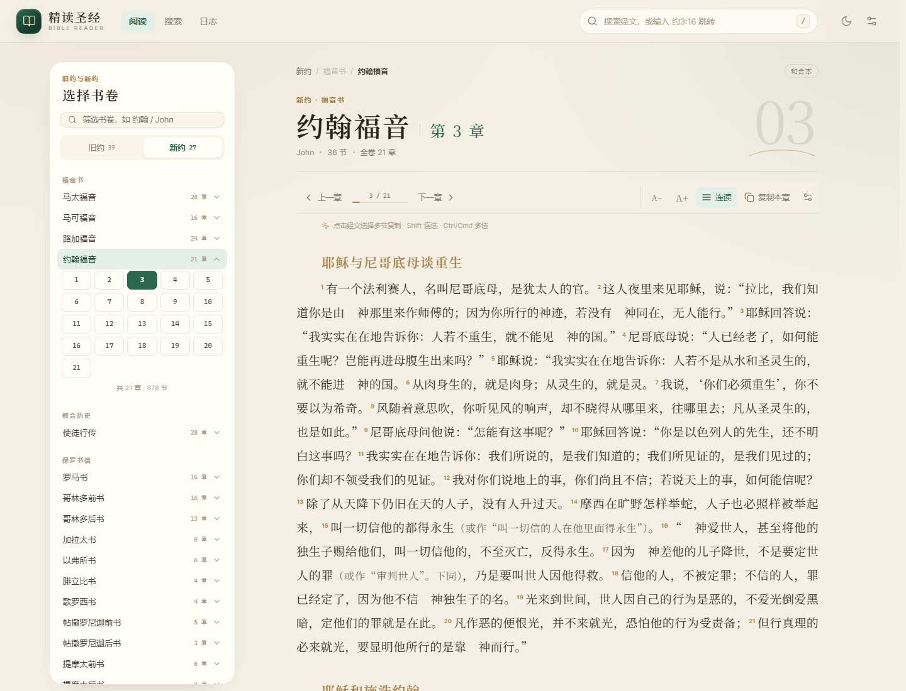
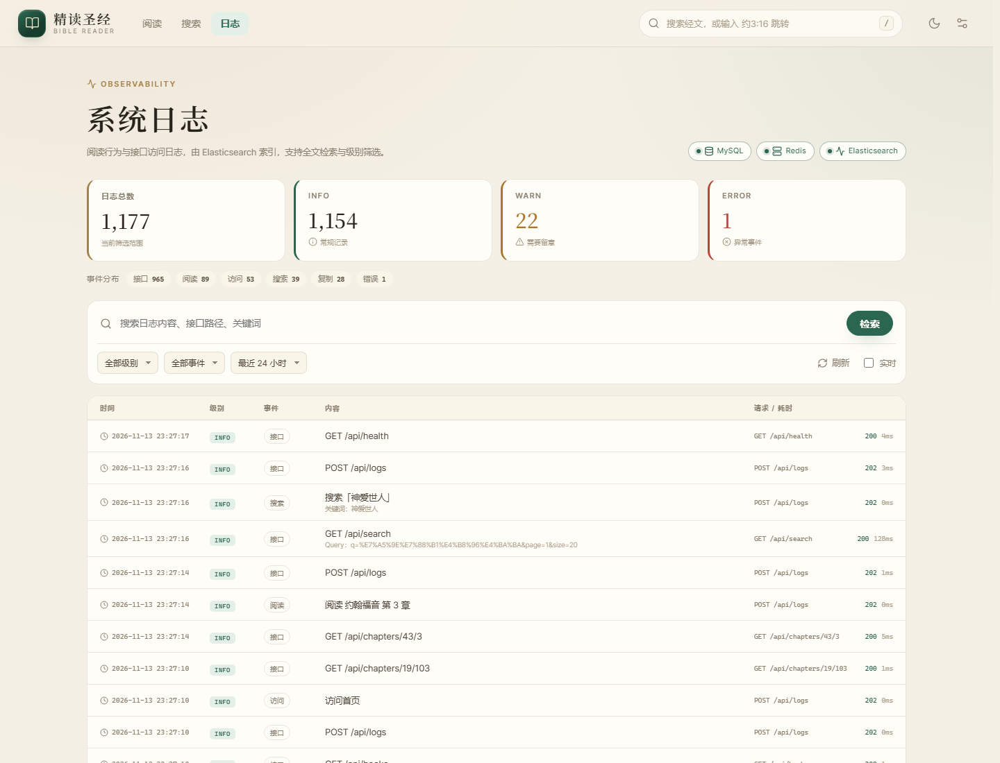
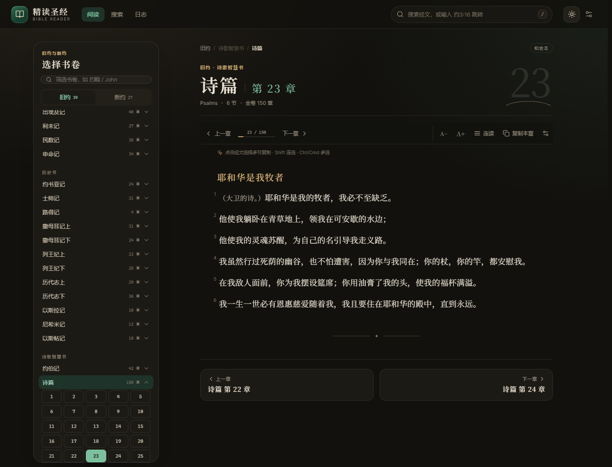
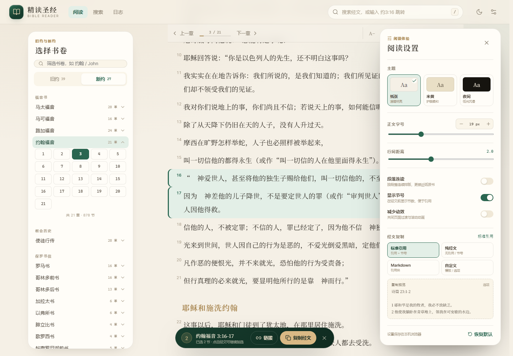
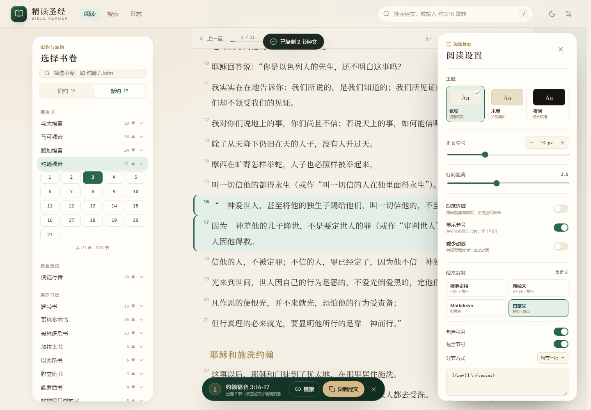
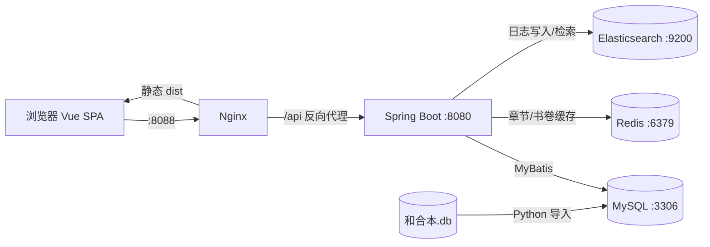

# 精读圣经 · Bible Reader

一个以中文和合本为正文的响应式读经 Web 应用。支持 **书卷 / 章节选择阅读、全文搜索、经文引用跳转、点选复制**，并附带一个由 **Elasticsearch** 驱动的行为与接口日志检索系统。

> 数据来源：`D:\file\study\圣经\精读圣经\bibles\和合本.db`（SQLite）
> 规模：**66 卷 · 1,189 章 · 31,102 节 · 2,667 条分段标题**


## 界面预览

| 阅读（逐节） | 阅读（段落连读） |
| --- | --- |
|  |  |

| 全文搜索 | 日志检索 |
| --- | --- |
|  |  |

| 手机阅读 | 手机书卷抽屉 |
| --- | --- |
|  |  |

| 手机选择复制 | 夜间模式 |
| --- | --- |
|  |  |

| 复制样式设置 | 自定义复制模板 |
| --- | --- |
|  |  |


## 功能

| 模块 | 能力 |
| --- | --- |
| 阅读 | 书卷 / 章节树、上一章 / 下一章、章节进度、URL 直达、移动端抽屉目录 |
| 今日经文 | 热门金句库按日期随机抽取（允许重复），同一天固定、每天 00:00 更换，显示完整年月日 |
| 搜索 | 全本或指定书卷内搜索、多关键词空格分隔、结果高亮、分页、搜索历史 |
| 跳转 | 识别 `约3:16`、`诗23篇`、`约翰福音3章16节`、`John 3:16`、`1Cor 13:4` 等引用 |
| 复制 | 点选单节、`Shift` 连选、`Ctrl/Cmd` 多选；复制带书卷章节的引用格式、复制链接、复制整章；复制样式可选标准引用 / 纯经文 / Markdown / 自定义模板 |
| 精读 | 分段标题、诗篇卷标、逐节 / 段落连读、字号 / 行距调节、纸张 / 米黄 / 夜间主题 |
| 个性化 | 阅读历史、继续阅读、设置本地持久化、`←/→` 翻章、`/` 聚焦搜索、`Esc` 取消选择 |
| 日志 | Elasticsearch 全文检索、级别 / 事件 / 时间筛选、统计聚合、实时刷新、ES 降级回退 |
| 适配 | 桌面双栏、平板 / 手机抽屉与底部选择工具栏、打印样式 |

## 技术栈

- **前端**：Vue 3.5、Vite 6、Vue Router 4（Hash 路由）、lucide 图标，纯手写 CSS 设计系统（无 UI 框架）
- **后端**：Java 17、Spring Boot 3.3.5、MyBatis 3.0.3、HikariCP
- **数据**：MySQL 8.0（`utf8mb4`，ngram 全文索引）、Redis 3.2（缓存）、Elasticsearch 7.16.2（IK 中文分词）
- **部署**：Nginx 1.20.2（静态资源 + `/api` 反向代理）
- **工具**：Python 3.13（SQLite → MySQL 导入）、Maven 3.9.9

## 架构



- 章节内容、书卷列表、统计信息走 Redis 缓存；Redis 故障自动回源 MySQL。
- 每次阅读 / 搜索 / 复制 / 跳转和每个 `/api/**` 请求都会异步写入 ES；ES 故障时日志检索回退到后端内存环形缓冲。
- 前端不依赖后端模板，Nginx 只做静态资源与 API 代理。

## 目录结构

```
D:\file\aidemo\bible
├── frontend/                 Vue 3 前端
│   ├── src/
│   │   ├── views/            Home / Read / Search / Logs
│   │   ├── components/       导航、书卷侧栏、经文列表、选择栏、设置、Toast
│   │   ├── composables/      经文选择与复制
│   │   ├── data/             热门金句库（dailyVerses.js）
│   │   ├── api/              fetch 封装与埋点
│   │   ├── store.js          全局状态 / 本地设置
│   │   ├── styles/main.css   设计系统与响应式
│   │   └── router.js
│   └── dist/                构建产物（Nginx 根目录）
├── backend/                  Spring Boot 后端（详见 backend/README.md）
│   └── target/bible-reader.jar
├── db/
│   ├── schema.sql            MySQL 表结构
│   └── import_bible.py       SQLite → MySQL 导入脚本
├── deploy/
│   ├── nginx.conf            Nginx 站点配置（8088）
│   ├── start-all.ps1         一键启动 MySQL/Redis/ES/后端/Nginx
│   └── stop-all.ps1          停止后端与 Nginx（-All 含基础服务）
├── scripts/
│   └── verify.ps1            后端 API 冒烟测试（21 项）
├── docs/
│   ├── DATA_ANALYSIS.md      数据库分析报告
│   ├── BACKEND_SPEC.md       后端 API 契约
│   └── screenshots/          界面截图
├── .runtime/                 本地进程、日志、截图（不参与构建）
└── README.md
```

## 快速启动

### 一键启动（推荐）

```powershell
powershell -ExecutionPolicy Bypass -File D:\file\aidemo\bible\deploy\start-all.ps1
```

脚本会依次确保：

| 服务 | 端口 | 说明 |
| --- | --- | --- |
| MySQL 8.0.46 | 3306 | 系统 MySQL80，主库（`root/1106135`），`bible` 数据已导入 |
| MySQL 8.0.46（可选） | 3307 | 项目内回退实例（`root/11016135`） |
| Redis 3.2.100 | 6379 | `D:\dev\Redis-x64-3.2.100` |
| Elasticsearch 7.16.2 | 9200 | `D:\dev\elasticsearch`，512 MB 堆 |
| Spring Boot | 8080 | `backend/target/bible-reader.jar` |
| Nginx | 8088 | `frontend/dist` + `/api` 代理 |

启动完成后打开：**http://127.0.0.1:8088/**

停止后端与 Nginx（保留 MySQL / Redis / ES 进程）：

```powershell
powershell -ExecutionPolicy Bypass -File D:\file\aidemo\bible\deploy\stop-all.ps1
# 同时停止本项目启动的 MySQL / Redis / ES：
powershell -ExecutionPolicy Bypass -File D:\file\aidemo\bible\deploy\stop-all.ps1 -All
```

### 手动启动

```powershell
# 1) MySQL：确认系统 MySQL80 服务已在 3306 运行（root/1106135）
#    项目内 3307 仅作为回退实例，无需主动启动

# 2) Redis
& 'D:\dev\Redis-x64-3.2.100\redis-server.exe' 'D:\dev\Redis-x64-3.2.100\redis.windows.conf'

# 3) Elasticsearch
$env:ES_JAVA_OPTS='-Xms512m -Xmx512m'
& 'D:\dev\elasticsearch\bin\elasticsearch.bat'

# 4) 后端
$env:JAVA_HOME='D:\dev\Java\jdk-17'
cd D:\file\aidemo\bible\backend
& 'D:\dev\maven\apache-maven-3.9.9\bin\mvn.cmd' -DskipTests package
& 'D:\dev\Java\jdk-17\bin\java.exe' -jar target\bible-reader.jar

# 5) 前端 / Nginx
cd D:\file\aidemo\bible\frontend
& 'D:\dev\node\npm.cmd' install
& 'D:\dev\node\npm.cmd' run build
& 'D:\dev\nginx-1.20.2\nginx.exe' -p 'D:\dev\nginx-1.20.2' `
  -c 'D:\file\aidemo\bible\deploy\nginx.conf'
```

### 访问地址

| 页面 | URL |
| --- | --- |
| 阅读首页 | http://127.0.0.1:8088/ |
| 阅读（约翰福音 3 章） | http://127.0.0.1:8088/#/read/43/3 |
| 搜索 | http://127.0.0.1:8088/#/search?q=神爱世人 |
| 日志检索 | http://127.0.0.1:8088/#/logs |
| 后端 API | http://127.0.0.1:8080/api/books |
| ES 健康 | http://127.0.0.1:9200/_cluster/health |

> Nginx 使用 **8088** 而不是 80，避免 Windows 上端口 80 的权限 / 占用问题；可在 `deploy/nginx.conf` 中自行修改。

## MySQL 说明

已验证本机系统 MySQL80 可通过 **`127.0.0.1:3306` / `root` / `1106135`** 连接，圣经数据已导入 3306 的 `bible` 库，后端默认主库即 3306。

项目同时保留了一个 3307 回退实例（`root/11016135`，数据目录 `.runtime/mysql/data`），用于 3306 不可用时自动降级：

- 后端 DataSource 候选格式为 `host:port` 或 `host:port@password`；
- 默认候选：`127.0.0.1:3306,127.0.0.1:3307@11016135`；
- 默认密码：`1106135`（3306）；
- `start-all.ps1` 会优先检查 3306，仅在 3306 不可用时才启动 3307。

如需强制只使用 3306：

```powershell
$env:APP_DB_CANDIDATES='127.0.0.1:3306'
$env:APP_DB_PASSWORD='1106135'
```

对应配置在 `backend/src/main/resources/application.yml` 的 `app.db.*`。

## 数据导入

```powershell
# 默认导入 127.0.0.1:3306 / root / 1106135
& 'D:\dev\Python\Python313\python.exe' D:\file\aidemo\bible\db\import_bible.py
```

也可以显式指定：

```powershell
& 'D:\dev\Python\Python313\python.exe' D:\file\aidemo\bible\db\import_bible.py `
  --port 3306 --password 1106135
```

输出应包含：

```
book               66
chapter          1189
verse           31102
section_title    2667
```

详细分析（两个 db 的表结构、数据差异、为什么选用 `和合本.db`）见 [`docs/DATA_ANALYSIS.md`](docs/DATA_ANALYSIS.md)。

## API 摘要

统一响应：`{ "code": 0, "message": "ok", "data": ... }`

| 方法 | 路径 | 说明 |
| --- | --- | --- |
| GET | `/api/books` | 66 卷书卷信息 |
| GET | `/api/books/{bookId}/chapters` | 某卷的全部章 |
| GET | `/api/chapters/{bookId}/{chapter}` | 章节正文、分段标题、上一章 / 下一章 |
| GET | `/api/search?q=&page=&size=&bookId=` | 关键词 / 引用搜索 |
| GET | `/api/reference/parse?q=&bookId=` | 单独解析经文引用 |
| GET | `/api/stats` | 书卷 / 章 / 节 / 标题统计 |
| GET | `/api/health` | MySQL / Redis / ES 健康状态 |
| POST | `/api/logs` | 前端行为埋点（异步写 ES） |
| GET | `/api/logs/search?q=&level=&event=&from=&to=&page=&size=` | ES 日志检索与聚合 |

完整字段与错误码见 [`docs/BACKEND_SPEC.md`](docs/BACKEND_SPEC.md)。

```powershell
# 示例
Invoke-RestMethod 'http://127.0.0.1:8080/api/chapters/43/3' | ConvertTo-Json -Depth 4
Invoke-RestMethod 'http://127.0.0.1:8080/api/search?q=约3:16' | ConvertTo-Json -Depth 4
```

## 关键设计

### 搜索

- 先做引用解析（中文简称 / 全名 / 英文名 / 英文缩写，最长别名优先，支持 `章/篇/节`、`:`、`-`、全角字符）。
- 非引用时按空白拆分关键词，MySQL `LIKE` 做 AND 子串匹配；返回服务端计算的 `highlights: [[start,end]]`，前端按区间渲染 `<mark>`，避免 XSS。
- 31k 节数据量下 `LIKE` 为毫秒级；`verse.content` 同时建了 `ngram` 全文索引，便于后续切换相关度排序。

### 选择与复制

- 单击选中，再次单击取消；`Shift` 连选，`Ctrl/Cmd` 多选。
- 选择态由 `composables/useSelection.js` 统一维护，底部固定工具栏显示 `书卷 章:起-止`。
- 复制格式：

```
约翰福音 3:16-18

16 “　神爱世人，甚至将他的独生子赐给他们……
17 ……
18 ……
```

- 设置面板 →「经文复制」提供四种样式：**标准引用**（默认）、**纯经文**（无引用/节号）、**Markdown 引用块**、**自定义**。
- 自定义模式可开关引用行、节号，选择每节一行 / 空行分隔 / 连续排版，并可使用模板：
  `{ref}`、`{book}`、`{chapter}`、`{range}`、`{count}`、`{verses}`、`{text}`、`{version}`。
- 模板留空时按选项生成；填写模板时模板优先（`{ref}` 是否输出仍受「包含引用」开关控制，`{verses}` 的节号/排版受对应选项控制）。
- 单节复制、多节选择复制、搜索页单节复制、复制整章均使用同一套样式。

### 今日经文

- 金句库位于 [`frontend/src/data/dailyVerses.js`](frontend/src/data/dailyVerses.js)，当前 **120 条**热门金句，可直接增删对象维护。
- 以 `YYYY-MM-DD` 日期为种子做 FNV-1a 哈希，从列表随机抽取；同一天始终展示同一节，不同日期重新抽取，**允许重复**。
- 结果按 `bible:daily:v2:{date}:{book}:{chapter}:{verse}` 缓存在 localStorage，跨过零点后每分钟自动检查并换新。
- 卡片日期显示为 `2026年11月13日`，并展示金句主题标签与「每日更新」提示（不显示金句总数）。

### 缓存与降级

- Redis key：`bible:v1:books`（1h）、`bible:v1:chapter:{book}:{chapter}`（30m）、`bible:v1:stats`（10m）。
- 所有 Redis 操作捕获异常；Redis 不可用时自动回源 MySQL，接口不受影响。
- ES 不可用时，日志写入内存环形缓冲（500 条），日志页显示"降级模式"。

### 日志系统

- 索引：`bible-logs-yyyy.MM.dd`，模板 `bible-logs-template`。
- 字段：`@timestamp / level / event / message / path / method / status / durationMs / ip / userAgent / query / bookId / chapter / verse / detail`。
- `message`、`query` 使用 **IK 中文分词**（`ik_max_word`），前端行为事件与接口日志统一检索。
- 页面支持按关键词、级别、事件、时间范围过滤，聚合展示事件分布与级别统计。

## 验证

```powershell
# 后端 21 项 API 冒烟测试（需后端、MySQL、Redis、ES 已启动）
powershell -ExecutionPolicy Bypass -File D:\file\aidemo\bible\scripts\verify.ps1
```

- 数据库：66 / 1,189 / 31,102 / 2,667，逐章逐节连续无缺。
- API：书卷、章节、上下章、引用解析、关键词搜索、日志检索、健康检查均返回预期数据；后端 12 项验收 + 21 项冒烟断言全部通过。
- 浏览器（Chrome Headless + Puppeteer）：桌面 1440×1000 与移动 390×844 两种视口下，阅读 / 搜索 / 日志页面无横向溢出；点选、Shift 连选、复制、复制链接、复制整章、章节跳转、书卷抽屉、搜索分页、书卷内搜索、日志级别筛选、夜间主题持久化、复制样式（纯经文 / 自定义模板）等 **33 项 UI 断言全部通过**。
- 结果截图见 `docs/screenshots/`。

## 开发

```powershell
# 前端热更新（Vite 代理 /api 到 8080）
cd frontend
& 'D:\dev\node\npm.cmd' run dev
# http://127.0.0.1:5173
```

后端可用 IDE 打开 `backend`，JDK 17；修改后 `mvn spring-boot:run` 或重新打包。

## 已知限制

- 采用和合本单一译本；`信望爱` 库的 Strong 标记未导入（保留原始标签会干扰阅读与复制）。
- 主库为系统 MySQL80 3306；3307 仅作为回退实例保留，长期不用可删除 `.runtime/mysql`。
- Elasticsearch 为单节点、无认证，仅适合本机开发；生产环境应开启安全认证并配置副本。
- 日志检索页面向本机使用，未做登录鉴权；公网部署前请加访问控制。

## License

经文数据来自用户本地 `和合本.db`，仅用于个人研读；代码可自由修改使用。
